# Authelia-Benutzerverwaltung mit Traefik

Mit diesem Projekt sollst du auf deinem eigenen Server eine Anmeldung mit Authelia und eine Benutzerverwaltung hinter Traefik einrichten können. Du brauchst dafür keine fertigen Linux-Kenntnisse: Kopiere die Vorlage unten in deine KI und lass dich Schritt für Schritt begleiten.

> **Stand: Entwicklungsversion.** Der Quellcode der Benutzerverwaltung und die Installationsanleitung sind noch nicht für einen öffentlichen Produktivbetrieb freigegeben. Die KI soll zuerst Traefik und das offizielle Authelia einrichten und prüfen. Die zusätzliche Benutzerverwaltung darf sie erst nach erfolgreicher Sicherheitsprüfung und einem eigenen isolierten Funktionstest aktivieren. Details: [Entwicklungsstand](ENTWICKLUNG.md).

> **Versionshinweis:** Der hier enthaltene historische Patch betrifft Authelia 4.39.16. Neuere Authelia-Versionen enthalten Sicherheitskorrekturen; siehe die [Upstream-Hinweise zu 4.39.20](https://github.com/authelia/authelia/releases/tag/v4.39.20). Installiere 4.39.16 nicht allein aufgrund dieses Repositories. Eine [experimentelle Portierung auf 4.39.28](scripts/authelia_onboarding/patches/v4.39.28/README.md) wurde isoliert getestet; sie ist nicht für den Einsatz freigegeben: Ein isolierter Fehlertest hat bei aufeinanderfolgenden Dateifehlern eine Abweichung zwischen Speicher und Datei nachgewiesen; die Korrektur läuft.

## So sieht die Benutzerverwaltung aus

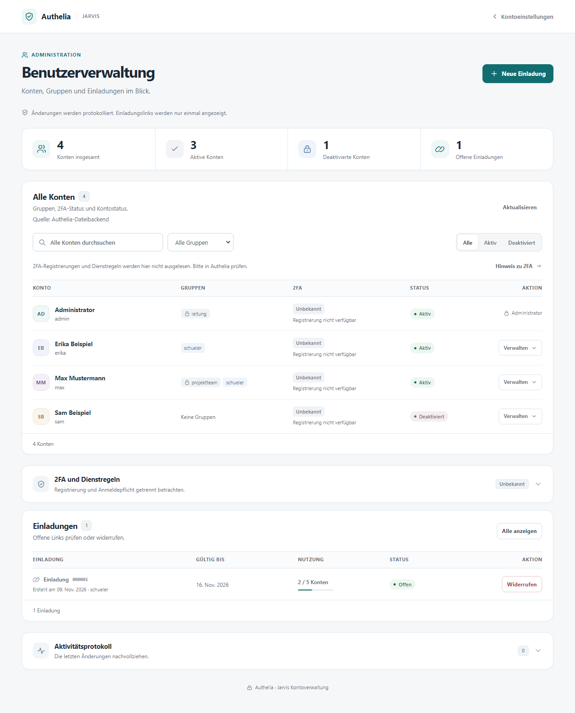


*Aufnahmen einer isolierten Vorschau mit erfundenen Testkonten. Sie zeigen eine Entwicklungsfassung; sie sind kein Nachweis einer fertigen Installation.*

## Funktionen der Benutzerverwaltung

Die separate Oberfläche bündelt Funktionen rund um Authelia-Konten:

- **Einladungen:** Administratoren erstellen zeitlich und in der Anzahl der Einlösungen begrenzte Einladungen, sehen deren Status und können sie widerrufen. Berechtigte Gruppen lassen sich vorgeben.
- **Konto anlegen:** Eingeladene wählen selbst ihren Benutzernamen und ihr Passwort über einen Einladungslink. Der Link ist ein Zugangsschlüssel und gehört nicht in öffentliche Chats oder Screenshots.
- **Konten und Gruppen:** Administratoren suchen Konten, bearbeiten ausdrücklich freigegebene Gruppen und deaktivieren Konten. Bei einem inzwischen geänderten Gruppenstand wird ein veraltetes Speichern abgewiesen.
- **Sicherheit:** Die Verwaltungsroute soll über Traefik und Authelia erst nach Anmeldung mit zwei Faktoren erreichbar sein. Die Konfiguration und ihre tatsächlichen Netzwerkgrenzen müssen im eigenen System geprüft werden.

Die Bilder zeigen ausschließlich synthetische Vorschauen einer Entwicklungsfassung. Der aktuelle Stand ist noch nicht zur Installation auf einem öffentlich erreichbaren System freigegeben.

## Schnellstart: Prompt für deine KI

Kopiere den gesamten Kasten in ChatGPT, Claude, Codex oder eine andere KI mit Zugriff auf deinen Server beziehungsweise der Möglichkeit, dich durch die Befehle zu begleiten:

```text
Du bist mein geduldiger Linux-, Proxmox- und Netzwerk-Administrator. Hilf mir,
auf meinem eigenen VPS mit Proxmox VE und Debian 13 Traefik, Authelia,
eine geschützte Testseite und später die Benutzerverwaltung aus diesem
Repository einzurichten:
https://github.com/WaldemarFech/authelia-onboarding

Erkläre mir die Schritte einfach. Prüfe das System selbst, wenn du Zugriff
hast; sonst gib mir ausführbare Schritte und sage, welche Ausgaben du brauchst.
Erfinde keine Zugänge, IP-Adressen oder Ergebnisse.

Frage mich zuerst gesammelt:
- Welche Domain und welche Subdomains für Anmeldung und Testseite nutze ich?
- Wie heißt mein erster Administrator, und welche E-Mail-Adresse wird für
  sein Konto benötigt? Ein funktionierender Mailserver ist zunächst nicht nötig.
- Habe ich Zugriff auf DNS, Proxmox und die Konsole meines VPS-Anbieters?
- Welche Dienste laufen bereits und dürfen nicht unterbrochen werden?
- Möchte ich eine Authenticator-App oder einen Sicherheitsschlüssel nutzen?
- Möchte ich später Jellyfin mit Authelia als Anmelde-Backend verbinden?

Untersuche vor Änderungen: öffentliche IPv4/IPv6, Provider-Vorgaben, vorhandene
Netze, Bridges, Routen, Firewall und NAT, belegte Ports, Container-IDs, freien
Speicher und bestehende Dienste. Diese Werte stammen aus einer Beispielanlage,
sind aber ausdrücklich nur Vorschläge und müssen bei mir geprüft werden:

- internes Netz 192.168.100.0/24, Gateway 192.168.100.1;
- Traefik: LXC 1003, 192.168.100.3;
- Authelia: LXC 1004, 192.168.100.4;
- kleine Testseiten: LXC 100032, 192.168.100.32.

Wenn etwas bereits belegt ist oder zum Provider nicht passt, verwende freie,
passende Alternativen. Erstelle einen Netzplan und erkläre, ob eine zusätzliche
vmbr-Bridge, IPv4-Forwarding, ausgehendes NAT und DNAT für TCP 80/443 nötig
sind. Prüfe vorhandene Regeln und verhindere Konflikte. Sichere die bisherige
Konfiguration und stelle einen Konsolen-Zugang und Rückfallweg sicher, bevor
du das Netz oder die Firewall änderst. IPv6 nur veröffentlichen, wenn der
Pfad vollständig eingerichtet und gefiltert ist.

Arbeite in überprüfbaren Etappen:
1. Erstelle geeignete Debian-13-LXCs und richte DNS und Netzwerk ein.
2. Installiere eine aktuell unterstützte Traefik-Version und eine einfache
   statische Testseite. Stelle sie zunächst ohne Authelia mit gültigem HTTPS
   bereit und teste DNS, Zertifikat und Erreichbarkeit.
3. Installiere offizielles Authelia und erstelle mein erstes Konto. Verwende
   die Dokumentation passend zu den tatsächlich installierten Versionen.
4. Ohne Mailserver: Prüfe, ob der offizielle Filesystem-Notifier für die
   erste Registrierung geeignet ist. Erkläre mir, wie ich die einmalige
   Nachricht selbst über eine geschützte Konsole einsehe und die 2FA-App
   registriere. Lies oder kopiere keine Codes, Links, QR-Codes, Passwörter,
   TOTP-Schlüssel oder Tokens in den Chat, in Toolausgaben oder Logs.
   Die Notifier-Datei ist sensibel und der Dateimodus nur eine Testlösung.
5. Schütze die Testseite mit Traefik ForwardAuth und Authelia. Prüfe, dass
   anonyme Nutzer, falsche Passwörter, fehlender zweiter Faktor, gefälschte
   Identitätsheader und direkte Backendzugriffe keinen Zugang erhalten;
   prüfe auch die erfolgreiche Anmeldung mit Passwort und zweitem Faktor.
6. Lies dann die README und ENTWICKLUNG.md dieses Repositories. Die eigene
   Benutzerverwaltung ist derzeit ein experimenteller Quellstand und nicht
   installationsfertig. Prüfe ihre Versionsbindung und offenen Sicherheits-
   und Integrationstests. Baue und teste sie nur in einem isolierten Labor
   mit Testkonten; aktiviere sie nicht öffentlich, solange die dokumentierten
   Freigabebedingungen nicht erfüllt und von dir nachgewiesen sind.

Wenn ich Jellyfin nutzen möchte, erkläre das separate Authelia-Plugin und
die ausdrückliche Gruppenregel. Unterscheide 2FA im Browser von nativen
Jellyfin-Clients und prüfe, wie bestehende Sitzungen nach Entzug enden.

Lege Geheimnisse direkt auf dem System geschützt an; schreibe sie nie ins
Repository oder in den Chat. Dokumentiere die gewählten IPs, DNS-Namen,
Container, Konfigurationsorte, Backups und die Ergebnisse der echten Tests.
Erkläre mir abschließend, wie ich eine weitere Seite und weitere Benutzer
hinzufüge, und unterscheide fertige Schritte von offenen Punkten.
```

## Funktionsgalerie

Die Aufnahmen zeigen die tatsächliche Oberfläche mit **simulierten API-Antworten und erfundenen Konten**. Es wurden keine gültigen Einladungslinks, Passwörter oder Tokens aufgenommen. Die Bilder sind eine Vorschau und kein Nachweis einer fertig installierten Anlage.

### Konten verwalten

Konten suchen, ihren Status sehen und Aktionen aufrufen.


### Gruppen zuweisen

Nur ausdrücklich freigegebene Gruppen bearbeiten; andere Gruppen bleiben erhalten.

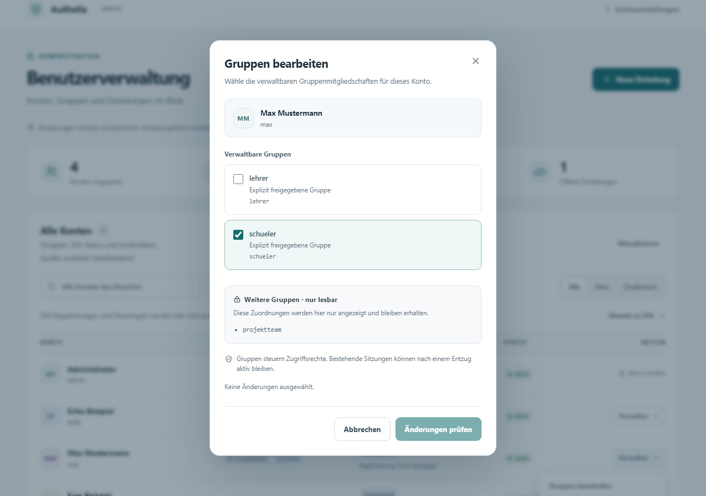

### Einladung erstellen

Gültigkeitsdauer, Anzahl neuer Konten und freigegebene Gruppen auswählen.

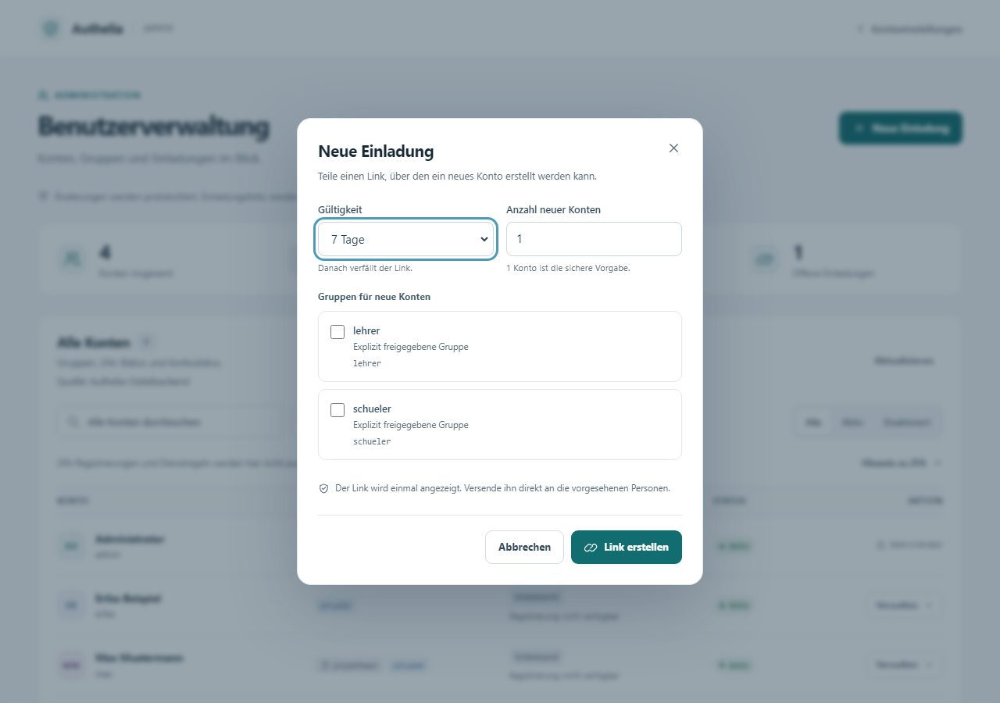

### Einladungen im Blick behalten

Offene, verbrauchte und widerrufene Einladungen unterscheiden; offene Einladungen können widerrufen werden.

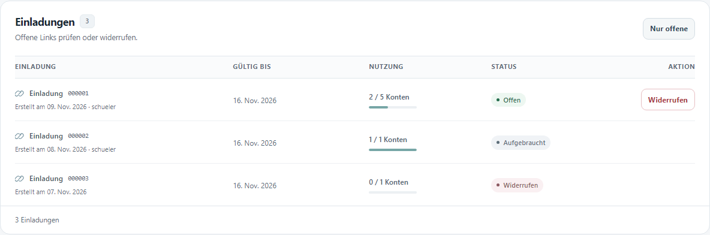

### Einladung annehmen

Die eingeladene Person erstellt ihr Konto selbst; im Beispiel bleiben die Passwortfelder leer.

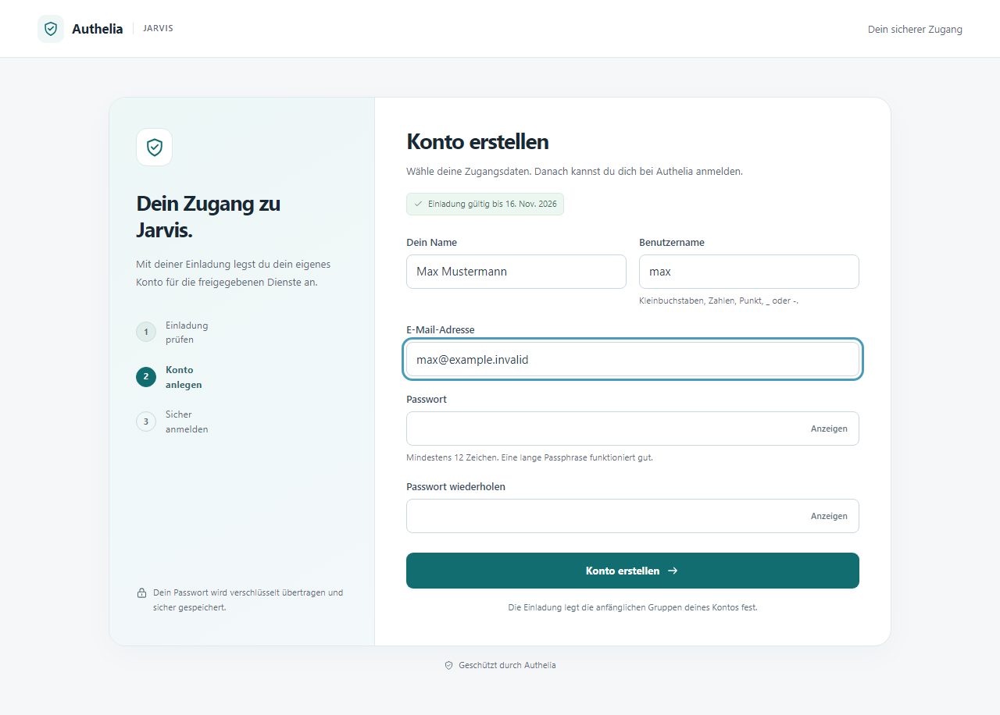

<details>
<summary>Dieselben Ansichten auf dem Smartphone</summary>

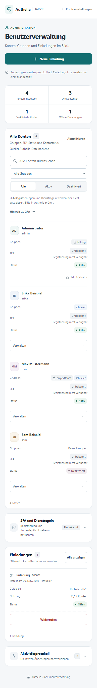


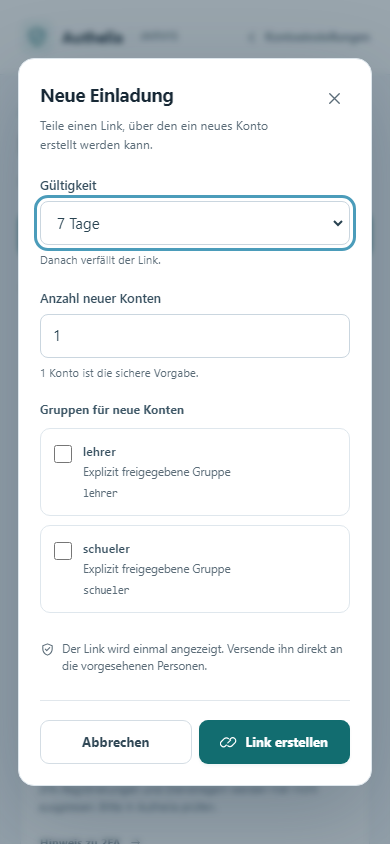

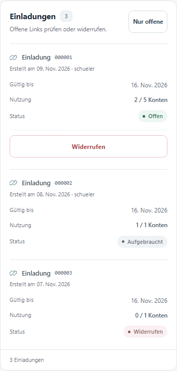

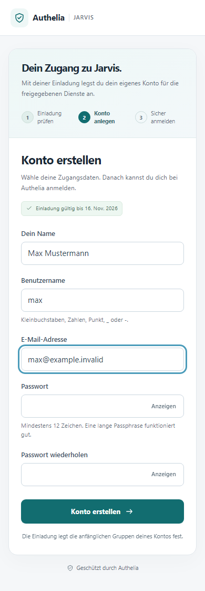

</details>

## Historischer Vergleich: native Kontoseite

So sah die native Settings-Startseite von Authelia **4.39.16** im Original und mit unserer damaligen Jarvis-Erweiterung aus. Beide Ansichten verwenden die echten jeweiligen Frontend-Dateien und dieselben simulierten Kontodaten. Der Vergleich ist **historisch**: Die Erweiterung ist für 4.39.28 noch nicht nachgewiesen und kein Bestandteil einer freigegebenen Installation. Die Aufnahmen belegen weder den Zustand einer laufenden Anlage noch eine echte Anmeldung.

| Original Authelia 4.39.16 | Jarvis-Erweiterung für 4.39.16 |
| --- | --- |
| 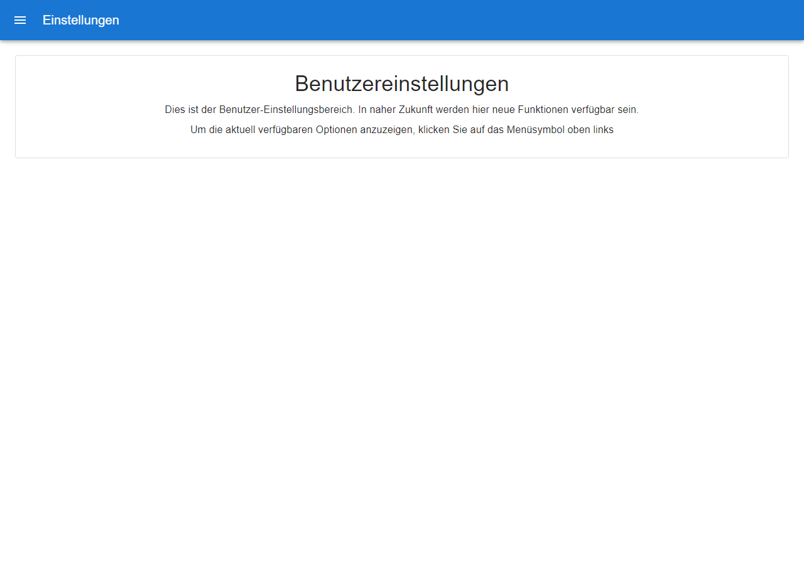 | 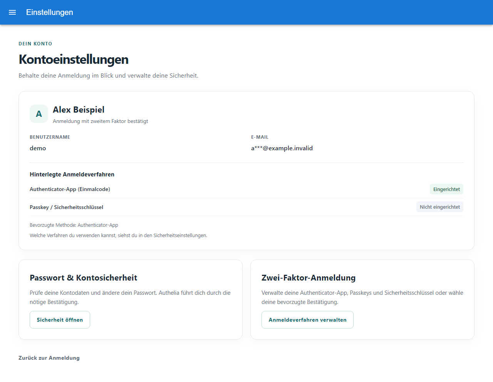 |

<details>
<summary>Historischer Vergleich auf dem Smartphone</summary>

**Original Authelia 4.39.16**

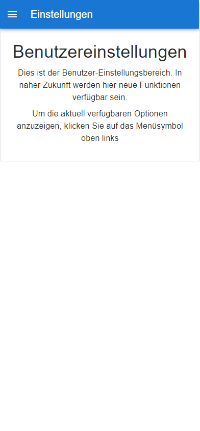

**Jarvis-Erweiterung für 4.39.16**

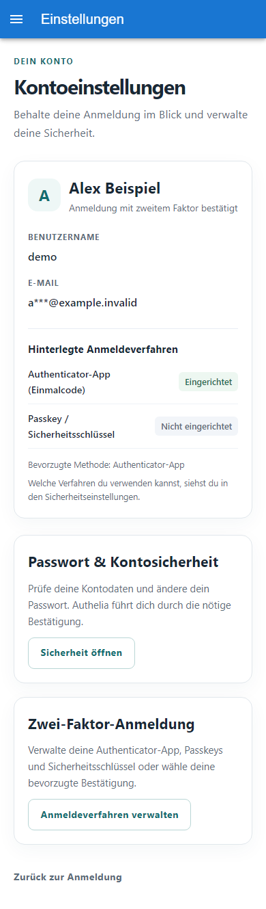

</details>

Das Original verweist auf dieser Startseite über das Menü auf weitere vorhandene Optionen. Die Vergleichsbilder zeigen weder, dass dem Original sämtliche Kontofunktionen fehlen, noch beweisen sie die Funktion der Schaltflächen. Die oben gezeigte Benutzerverwaltung mit Einladungen ist ein separater Zusatzdienst und hat keine entsprechende originale Verwaltungsseite in diesem Vergleich.

## Beispiel: Jellyfin mit Authelia verbinden

Über ein separates [Jellyfin-Authelia-Plugin](https://github.com/nikarh/jellyfin-plugin-authelia) kann Jellyfin Authelia als Anmelde- und Autorisierungs-Backend verwenden. Eine Gruppe wie `jellyfin-users` kann in einer **ausdrücklichen Authelia-Zugriffsregel** festlegen, wer sich bei Jellyfin neu anmelden darf. Der Gruppenname allein schaltet keine Funktion frei; Plugin, Authelia-Regel und die in dieser Verwaltung erlaubten Gruppen müssen zusammenpassen. Ein [Fork des Plugins](https://github.com/WaldemarFech/jellyfin-plugin-authelia) ist ebenfalls öffentlich; seine Aktualität und Kompatibilität müssen vor Einsatz geprüft werden.

Wichtig: Das Plugin beschreibt für native Jellyfin-Clients Benutzername und Passwort **ohne 2FA**. Eine getrennte Browser-Route kann über Traefik und Authelia anders geschützt werden. Bereits ausgestellte Jellyfin-Sitzungen oder Tokens können nach einem Gruppenentzug oder einer Kontosperre weiter gültig sein; sie müssen gegebenenfalls in Jellyfin separat beendet werden. Prüfe beide Wege und die tatsächlichen Regeln in deinem eigenen System.

## Was ist hier enthalten?

- Eine separate Benutzerverwaltung für Einladungen, Konten und Gruppen.
- Ein historischer Patch für Authelia 4.39.16 und eine [experimentelle Portierung für 4.39.28](scripts/authelia_onboarding/patches/v4.39.28/README.md) zur koordinierten Bearbeitung der Benutzerdatei.
- Eine experimentelle Erweiterung der Authelia-Oberfläche und eine **noch nicht freigegebene** [Laboranleitung](LAB-INSTALL.md).

Die Benutzerverwaltung ist kein eigenständiger vollständiger Authelia-Fork. Authelia selbst und Traefik werden separat installiert. [Entwicklungsstand und Einschränkungen](ENTWICKLUNG.md) erläutern Tests, Sicherheitsannahmen und noch offene Arbeiten. Die [Proxmox-Musterlösung](https://github.com/WaldemarFech/meine-proxmox-musterloesung) ist als unvollständiger Anfangsstand online. Den aktuellen Stand und offene Aufgaben dieses Repositories findest du im [Handover](HANDOVER.md).
