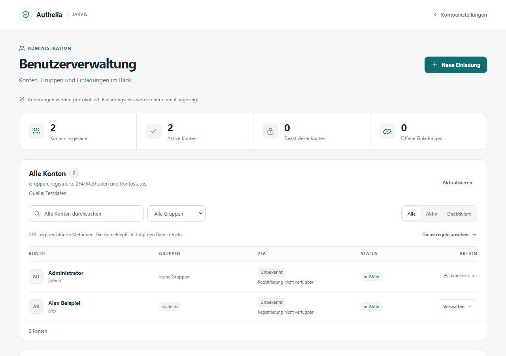
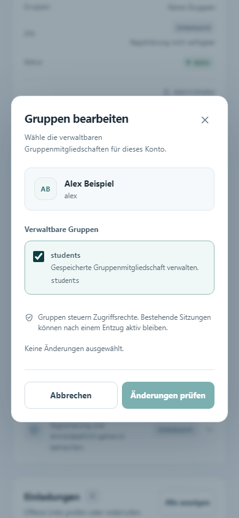

# Authelia-Benutzerverwaltung mit Traefik

Mit diesem Projekt sollst du auf deinem eigenen Server eine Anmeldung mit Authelia und eine Benutzerverwaltung hinter Traefik einrichten können. Du brauchst dafür keine fertigen Linux-Kenntnisse: Kopiere die Vorlage unten in deine KI und lass dich Schritt für Schritt begleiten.

> **Stand: Entwicklungsversion.** Der Quellcode der Benutzerverwaltung und die Installationsanleitung sind noch nicht für einen öffentlichen Produktivbetrieb freigegeben. Die KI soll zuerst Traefik und das offizielle Authelia einrichten und prüfen. Die zusätzliche Benutzerverwaltung darf sie erst nach erfolgreicher Sicherheitsprüfung und einem eigenen isolierten Funktionstest aktivieren. Details: [Entwicklungsstand](ENTWICKLUNG.md).

> **Versionshinweis:** Der hier enthaltene historische Patch betrifft Authelia 4.39.16. Neuere Authelia-Versionen enthalten Sicherheitskorrekturen; siehe die [Upstream-Hinweise zu 4.39.20](https://github.com/authelia/authelia/releases/tag/v4.39.20). Installiere 4.39.16 nicht allein aufgrund dieses Repositories. Die Portierung auf eine aktuell unterstützte Version wird geprüft.

## So sieht die Benutzerverwaltung aus





*Aufnahmen einer isolierten Vorschau mit erfundenen Testkonten. Sie zeigen eine Entwicklungsfassung; sie sind kein Nachweis einer fertigen Installation.*

## Schnellstart: Prompt für deine KI

Kopiere den gesamten Kasten in ChatGPT, Claude, Codex oder eine andere KI mit Zugriff auf deinen Server beziehungsweise der Möglichkeit, dich durch die Befehle zu begleiten:

```text
Du bist mein geduldiger Linux-, Proxmox- und Netzwerk-Administrator. Hilf mir,
auf meinem eigenen VPS mit Proxmox VE und Debian 13 Traefik, Authelia,
eine geschützte Testseite und später die Benutzerverwaltung aus diesem
Repository einzurichten:
https://github.com/WaldemarFech/authelia-onboarding

Erkläre mir die Schritte einfach. Prüfe das System selbst, wenn du Zugriff
hast; sonst gib mir ausführbare Schritte und sage, welche Ausgaben du brauchst.
Erfinde keine Zugänge, IP-Adressen oder Ergebnisse.

Frage mich zuerst gesammelt:
- Welche Domain und welche Subdomains für Anmeldung und Testseite nutze ich?
- Wie heißt mein erster Administrator, und welche E-Mail-Adresse wird für
  sein Konto benötigt? Ein funktionierender Mailserver ist zunächst nicht nötig.
- Habe ich Zugriff auf DNS, Proxmox und die Konsole meines VPS-Anbieters?
- Welche Dienste laufen bereits und dürfen nicht unterbrochen werden?
- Möchte ich eine Authenticator-App oder einen Sicherheitsschlüssel nutzen?

Untersuche vor Änderungen: öffentliche IPv4/IPv6, Provider-Vorgaben, vorhandene
Netze, Bridges, Routen, Firewall und NAT, belegte Ports, Container-IDs, freien
Speicher und bestehende Dienste. Diese Werte stammen aus einer Beispielanlage,
sind aber ausdrücklich nur Vorschläge und müssen bei mir geprüft werden:

- internes Netz 192.168.100.0/24, Gateway 192.168.100.1;
- Traefik: LXC 1003, 192.168.100.3;
- Authelia: LXC 1004, 192.168.100.4;
- kleine Testseiten: LXC 100032, 192.168.100.32.

Wenn etwas bereits belegt ist oder zum Provider nicht passt, verwende freie,
passende Alternativen. Erstelle einen Netzplan und erkläre, ob eine zusätzliche
vmbr-Bridge, IPv4-Forwarding, ausgehendes NAT und DNAT für TCP 80/443 nötig
sind. Prüfe vorhandene Regeln und verhindere Konflikte. Sichere die bisherige
Konfiguration und stelle einen Konsolen-Zugang und Rückfallweg sicher, bevor
du das Netz oder die Firewall änderst. IPv6 nur veröffentlichen, wenn der
Pfad vollständig eingerichtet und gefiltert ist.

Arbeite in überprüfbaren Etappen:
1. Erstelle geeignete Debian-13-LXCs und richte DNS und Netzwerk ein.
2. Installiere eine aktuell unterstützte Traefik-Version und eine einfache
   statische Testseite. Stelle sie zunächst ohne Authelia mit gültigem HTTPS
   bereit und teste DNS, Zertifikat und Erreichbarkeit.
3. Installiere offizielles Authelia und erstelle mein erstes Konto. Verwende
   die Dokumentation passend zu den tatsächlich installierten Versionen.
4. Ohne Mailserver: Prüfe, ob der offizielle Filesystem-Notifier für die
   erste Registrierung geeignet ist. Erkläre mir, wie ich die einmalige
   Nachricht selbst über eine geschützte Konsole einsehe und die 2FA-App
   registriere. Lies oder kopiere keine Codes, Links, QR-Codes, Passwörter,
   TOTP-Schlüssel oder Tokens in den Chat, in Toolausgaben oder Logs.
   Die Notifier-Datei ist sensibel und der Dateimodus nur eine Testlösung.
5. Schütze die Testseite mit Traefik ForwardAuth und Authelia. Prüfe, dass
   anonyme Nutzer, falsche Passwörter, fehlender zweiter Faktor, gefälschte
   Identitätsheader und direkte Backendzugriffe keinen Zugang erhalten;
   prüfe auch die erfolgreiche Anmeldung mit Passwort und zweitem Faktor.
6. Lies dann die README und ENTWICKLUNG.md dieses Repositories. Die eigene
   Benutzerverwaltung ist derzeit ein experimenteller Quellstand und nicht
   installationsfertig. Prüfe ihre Versionsbindung und offenen Sicherheits-
   und Integrationstests. Baue und teste sie nur in einem isolierten Labor
   mit Testkonten; aktiviere sie nicht öffentlich, solange die dokumentierten
   Freigabebedingungen nicht erfüllt und von dir nachgewiesen sind.

Lege Geheimnisse direkt auf dem System geschützt an; schreibe sie nie ins
Repository oder in den Chat. Dokumentiere die gewählten IPs, DNS-Namen,
Container, Konfigurationsorte, Backups und die Ergebnisse der echten Tests.
Erkläre mir abschließend, wie ich eine weitere Seite und weitere Benutzer
hinzufüge, und unterscheide fertige Schritte von offenen Punkten.
```

## Was ist hier enthalten?

- Eine separate Benutzerverwaltung für Einladungen, Konten und Gruppen.
- Ein an Authelia 4.39.16 gebundener Patch für die koordinierte Bearbeitung der Benutzerdatei.
- Eine experimentelle Erweiterung der Authelia-Oberfläche und eine **noch nicht freigegebene** [Laboranleitung](LAB-INSTALL.md).

Die Benutzerverwaltung ist kein eigenständiger vollständiger Authelia-Fork. Authelia selbst und Traefik werden separat installiert. [Entwicklungsstand und Einschränkungen](ENTWICKLUNG.md) erläutern Tests, Sicherheitsannahmen und noch offene Arbeiten. Eine allgemeine Proxmox-Musterlösung ist geplant und folgt später.
